# Alidade UI acceptance

This note records what the desktop screens do, the captured shots, the Kaliber visual verdict after one fix wave, a measured single test from Task 2, and what is still out of scope.

## What each screen does

### Home

Home is the starting screen. It shows the current status, five KPI tiles (download, upload, idle ping, ping under load, loss), and the buttons **Run single test** and **Start continuous**. With no last single test, it shows an empty-state card.

### Continuous

Continuous shows a live multi-series chart, time-range chips (1 h, 6 h, 24 h, 7 d), and a table of the newest rounds. Pause, Resume, and Export CSV sit above the chart. The status pill reports running or paused.

### Ping monitor

Ping monitor lists each enabled target in a row with current latency, average, minimum, maximum, jitter, loss, and a sparkline. Start begins dense probing. A target with no answer is drawn in the danger colour.

### History

History filters stored rounds by From and To dates. It shows a count of rounds in range and a table of those rounds. Export CSV writes the filtered window.

### Settings

Settings holds the measurement interval, which metrics run, the targets table (game-server presets may carry an unverified badge), daily data budget, theme, Windows autostart, and notifications. Notifications use a master switch and three threshold rows. Windows notification toasts are rate-limited. The in-app removal toast works on every supported desktop platform.

## Shared controls (plan 120 p2)

| State | Expected result |
| --- | --- |
| Header | Alidade name and mark; Settings last; a quick Light/Dark switch. |
| Appearance | Light, Dark, System segments; same saved `theme` as the header switch; System follows the OS. |
| About closed | Last section of Settings; opening it uses the shared consent gate. |
| About, checks off | Version, explicit off message, consent checkbox, disabled Check now; no request from start, opening About, or Check now. |
| About, checks on | At most one request in flight; result and UTC time of the last check in this session; failures are shown. |
| Remove | Bottom-right Undo toast names the target for 10 seconds. Undo or Ctrl+Z restores its index, all fields, and raw port text. A stale timer cannot close a newer undo. |
| Help | Footer Help or F1 opens a searchable panel with idle ping, ping under load, jitter, and shortcuts. No animation; same text with reduced motion. |
| Keyboard | Ctrl+, opens Settings. Escape closes Help and returns focus to the previous control. Help has keyboard focus and opens with Enter or Space. Tab stays in help search; Settings and Undo shortcuts do not act through the panel. |
| Window | Default 1280 � 800, minimum 1008 � 640; the Settings body scrolls in its own gutter. |

This run follows the controller's capture-only limit of 2026-10-24: no Computer Use or global pointer/key input. The existing startup flags capture the header at the top of Settings and Appearance with the closed About heading at the end (`--scroll settings-notifications`). Captures use light and dark themes at 1280 x 800 and 1008 x 640. Files are `A:/tmp/120-p2-maker/shots/header-{theme}-{size}.png` and `settings-tail-{theme}-{size}.png`, where theme is light/dark and size is default/min.

Expanded About with checks off or on and a last result, Undo, Help, and focus-return images are skipped. No existing setting or startup flag opens these states, and no new capture path was added. For every theme/size pair the skipped names are `about-off-{theme}-{size}.png`, `about-on-{theme}-{size}.png`, `undo-{theme}-{size}.png`, `help-{theme}-{size}.png`, and `focus-return-{theme}-{size}.png`.

Unit evidence for these states is in `app/tests/support/t21.rs` (consent and last result), `t22.rs` (complete target restoration, expiry and Ctrl+Z), `t23.rs` (help, shortcuts, focus capture and panel state), and `screens/help.rs` (the focus operation restores the recorded control without widget IDs). These tests check the same state transitions for reduced motion because the toast and panel have no animation state. Logs are under `A:/tmp/120-p2-maker/`. The screenshots below are historical captures.

## Screenshots

All captures are 1280 by 800 pixels. Light is on the left. Dark is on the right.

### Home

| Light | Dark |
| --- | --- |
| 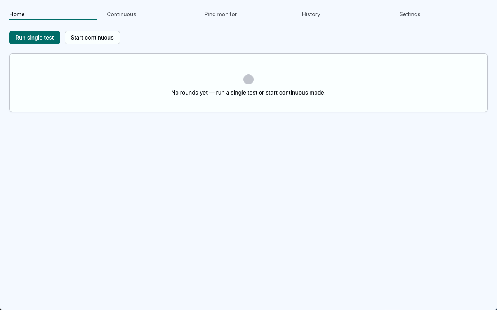 | 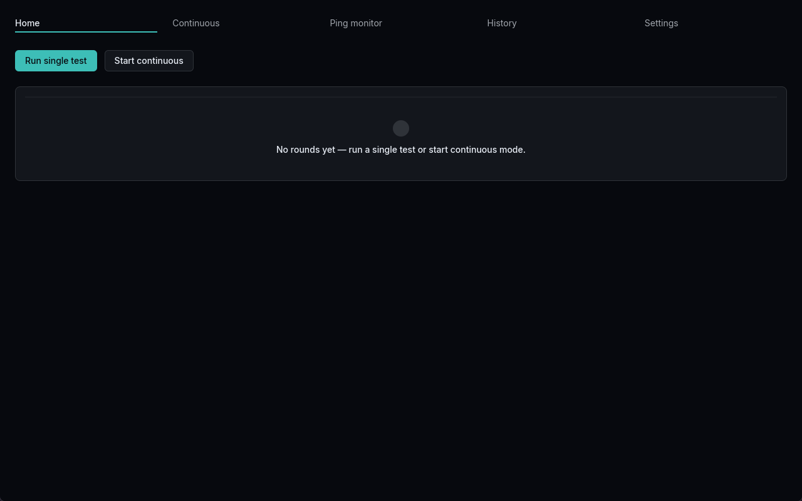 |

### Continuous

| Light | Dark |
| --- | --- |
| 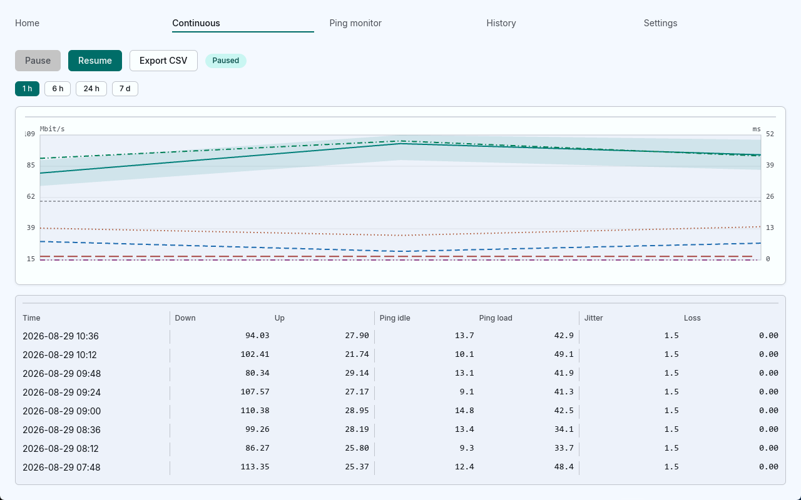 | 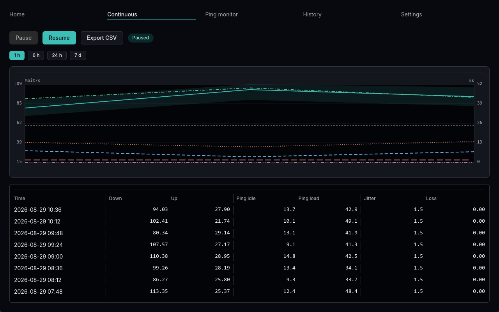 |

### Ping monitor

| Light | Dark |
| --- | --- |
| 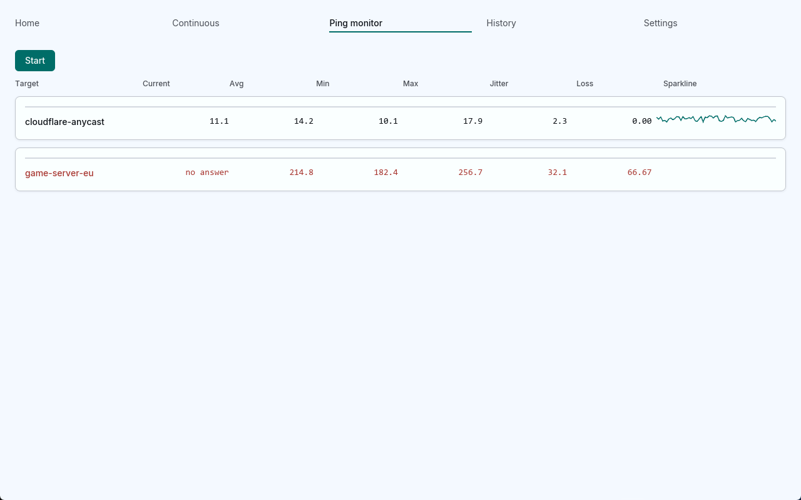 | 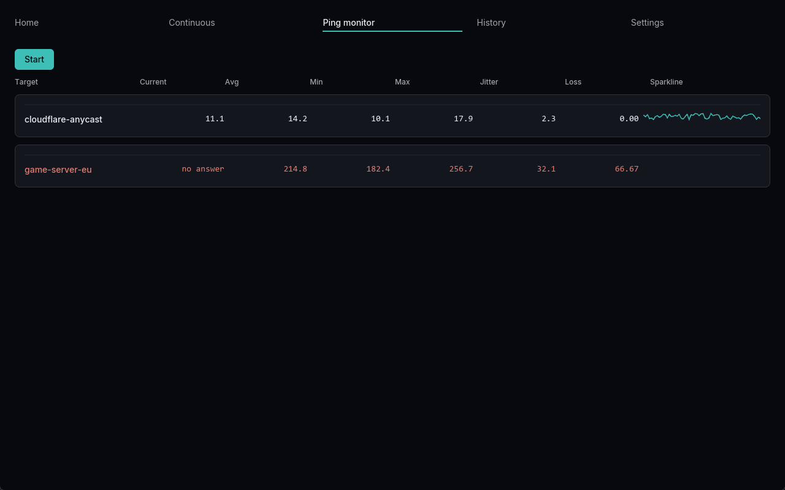 |

### History

| Light | Dark |
| --- | --- |
| 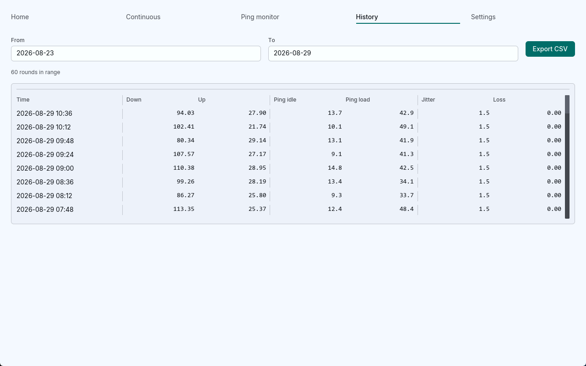 | 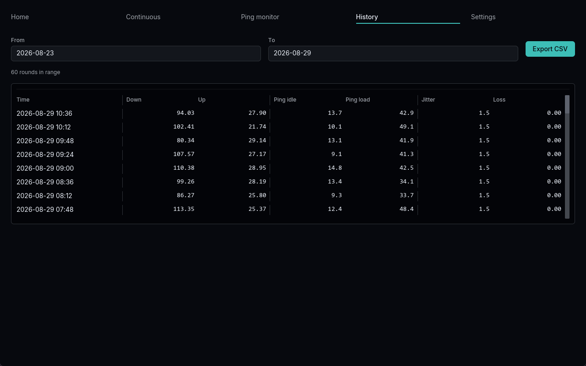 |

### Settings

| Light | Dark |
| --- | --- |
| 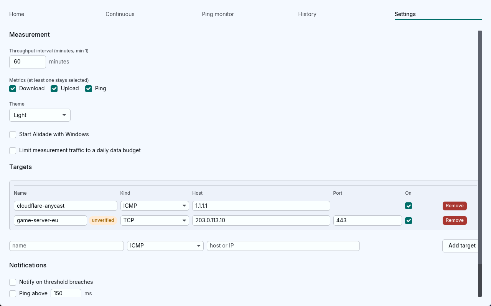 | 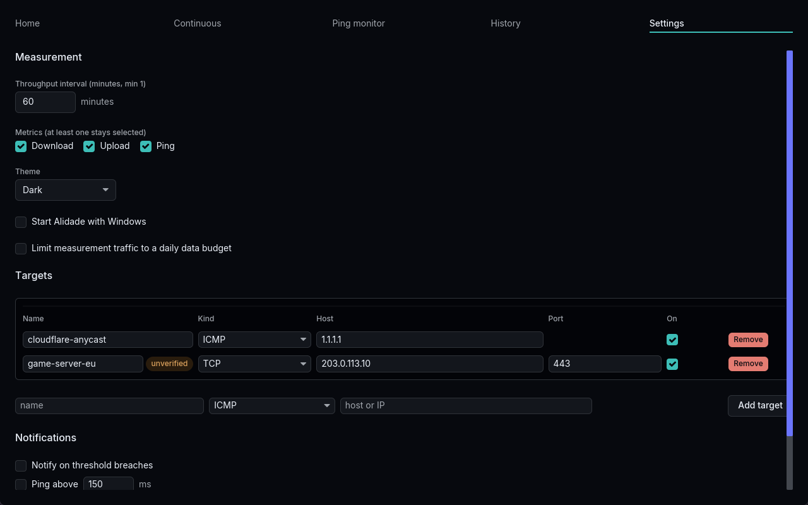 |

### Settings, Notifications block

These two shots use `--scroll settings-notifications` so the Notifications block is in view.

| Light | Dark |
| --- | --- |
| 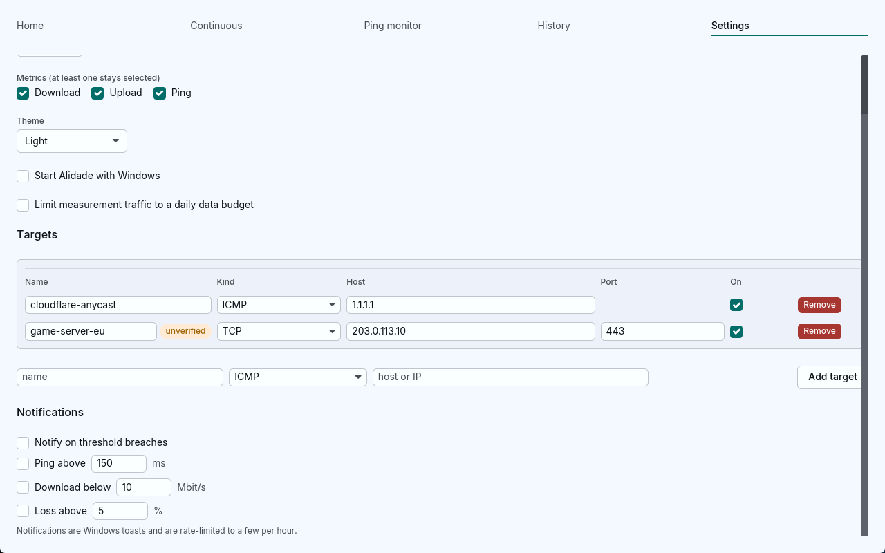 | 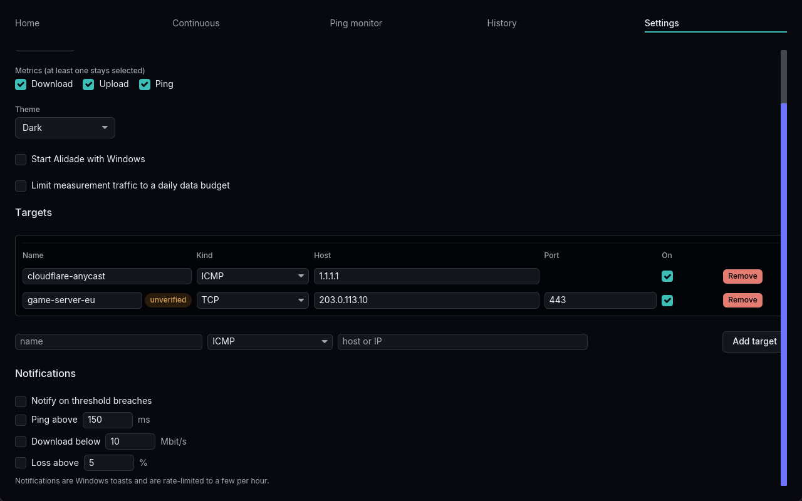 |

## Visual verdict

Final verdict (re-check after the fix wave):

> Verdict: PARTIAL for Kaliber conformance. The rendered app reads as the same hand as the gallery, but the missing danger-row sparkline and two remaining minor defects prevent a PASS.

### Open (not fixed)

- **Important.** `ping-light.png`, `ping-dark.png`: the `game-server-eu` row has historical measurements but its Sparkline cell is blank.

### Accepted minor findings

- **Minor.** All four Settings images: the page scrollbar overlaps the right edge of the Targets container and the **Add target** button.
- **Minor.** `home-light.png`, `home-dark.png`: the empty state still combines its title and guidance into one line.

### Closed in the fix wave (first-round findings)

- **Critical (closed).** Ping monitor had no enabled targets in the first shots. Re-check: both seeded targets are listed. `cloudflare-anycast` shows current `11.1` and a sparkline. `game-server-eu` is in the danger colour with current `no answer`.
- **Important (closed).** History Loss values were clipped. Re-check: the complete Loss header and every `0.00` value are visible. The scrollbar sits in its own gutter.
- **Important (closed).** Continuous showed three table rows instead of eight. Re-check: eight rounds and seven columns; the well is sized to those rows.
- **Important (closed).** Notification thresholds were below the fold. Re-check: the extra Notifications shots show the master checkbox and the three thresholds (`Ping above 150 ms`, `Download below 10 Mbit/s`, `Loss above 5 %`).
- **Important (superseded by Kaliber r4).** Cards and wells now use a flat fill and a 1 px hairline. The former top highlight and card shadow are removed in both themes.

The first-round verdict was also PARTIAL. The five Critical and Important items above were the reason. After the wave, only the blank danger-row sparkline remains Important.

## Measured single-test numbers (Task 2)

One GUI single test against `speed.cloudflare.com` on **2026-08-20**. The round timestamp in the store is `2026-08-20T21:22:02Z`.

| Metric | Value |
| --- | --- |
| Date | 2026-08-20 |
| Download | 195.94 Mbit/s |
| Upload | 14.98 Mbit/s |
| Ping idle | 22.2 ms (store idle ping 22.25 ms) |
| Ping under load | 21.7 ms |
| Jitter | not measured |
| Loss | 0.00% |

The CLI export of the same row is `2026-08-20T21:22:02Z,full,195.94,14.98,22.25,21.3,22.090909...,5,0,false,,10001.2773,10636.7028`. `ping_down_ms` 21.3 and `ping_up_ms` about 22.09 average to 21.7 ms on the tile.

These Home captures use the seeded demo database, not that Task 2 round. Home shows the last single test. The demo store has history rounds but no last single test, so Home is empty in these shots.

## Not covered yet

- Per-phase aggregate reporting is not in the UI.
- Chart zoom is not implemented. Range chips and hover are the only scale controls.
- Localisation: the UI is English only.
- Tray and toasts are Windows-first. macOS and Linux tray are not implemented.
- Live tray, left-click restore, close-to-tray, and toast appearance were proven by unit tests, not by a desktop capture (Task 6: live tray and toast could not be observed because desktop capture failed).
- Theme: `--theme light` and `--theme dark` produce distinct palettes in these shots. Choosing a theme in Settings is saved. A live OS dark-mode toggle for the System mode was not exercised on a real display.
- Tab-focus is a 2 px input border, not the gallery 2 px ring plus 2 px offset. Buttons have no focus ring (iced 0.14.2 limit, Task 5).
- Seconds on the Continuous countdown can skip because the tick is 1200 ms (Task 4).
- Ping samples match settings targets by name only. A renamed target that keeps the same name can inherit old samples (fix-wave note).
- Game-server presets in Settings may be unverified community data.

## How the screenshots were made

1. `seed_demo` writes a scratch store (60 rounds over 24 h, plus one hour of per-minute ping samples for `cloudflare-anycast` and `game-server-eu`) and a matching `settings.toml` next to it. Default path used by the shoot script: `%TEMP%\alidade-shoot\demo.db`.
2. `app/scripts/shoot.ps1` builds the app, seeds that database, then launches `alidade-app` with `--screen`, `--theme`, `--window 1280x800`, `--db`, and `--settings`.
3. The script waits a fixed 20 seconds, then takes one client-area capture. Polling `GetClientRect` right after launch often leaves the window at 0x0 for the rest of that process. The fixed wait avoids that stall.
4. Settings Notifications shots add `--scroll settings-notifications` so the scrollable snaps to the end before capture.
5. Home in this set is the empty state. Home reflects the last single test, not the seeded history table.
